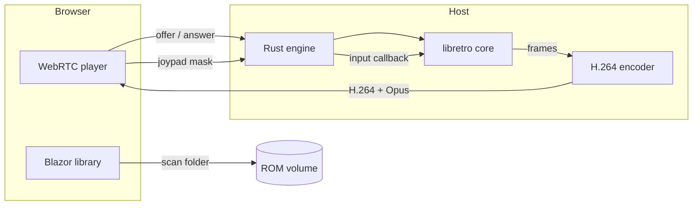

# PixelPipe

Self-hosted Plex for retro games. ROMs and libretro cores run on a machine you control. Gameplay video and audio are encoded on that machine and streamed to a browser on the same LAN, and controller input comes back over the same WebRTC session. PixelPipe is one application: it does not sit on top of Sunshine, Apollo, Moonlight, or RomM.

The latency target is about 10–30 ms end to end on a home network. The player HUD adds the pieces we can time: libx264 encode, data-channel RTT, the browser jitter buffer, and decode. On this development host, streaming the test ROM to a local Chrome tab measured about **0.2 ms encode, 0.1 ms decode, 1.2 ms RTT, 17–25 ms jitter buffer, and an estimated 18–26 ms** glass-to-glass. A headless self-test of the same 256×240 frame encoded in about 0.2 ms average. The jitter buffer is the largest term at this resolution; NVENC will not remove it, but it keeps the encode step small on a machine that is also doing other work. A browser on another LAN device adds its own RTT.

## Architecture

```text
browser (Blazor + MudBlazor)
    library grid, game detail, settings, player page
        |  HTTP  (library is scanned by the UI; session control is the engine)
        v
engine (Rust)
    libretro core  --video/audio callbacks-->  H.264 + Opus
        ^                                        |
        | data channel (gamepad / keyboard)      v
        +---------------- WebRTC ----------------+
```

- **UI** (`ui/PixelPipe.Web`): Blazor Server and MudBlazor. The library page scans a folder, shows box art, and opens a player page.
- **Engine** (`engine/`): loads a libretro core with `dlopen`, runs it headless, takes frames from the video callback and PCM from the audio callback, encodes H.264, encodes Opus, and sends both on a WebRTC peer connection. Browser input arrives on an unreliable data channel and is fed to `retro_input_state`.
- **Encoder order**, probed by actually opening the codec at startup: NVIDIA NVENC (`h264_nvenc`), Intel Quick Sync (`h264_qsv`), VAAPI (`h264_vaapi`), AMD AMF (`h264_amf`), then libx264. Machines without a GPU use libx264. The software path is tuned for latency (`ultrafast`, `zerolatency`, no B-frames, intra refresh off, headers repeated on every IDR). NVENC tries several driver profiles (`p1`/`ull`, then `llhp`, then `fast`, then no private options). The profile that opened is logged and shown on the settings page.
- **Packaging**: a Docker image for Unraid/NAS (`linux/amd64` and `linux/arm64`) and a native Windows x64 installer. Cores are downloaded from the libretro buildbot, not compiled into the engine. The ROM library is a folder, a Docker volume, or a UNC path such as `\\unas-pro\roms`.



## What works

- NES (FCEUmm), SNES (Snes9x), and Genesis (Genesis Plus GX) each play an original CC0 ROM. A self-test checks that the picture is not black, that audio samples are produced, that holding Right moves the on-screen cursor, that a frame round-trips through the selected H.264 encoder, and that a save state serializes.
- Encoder probe prefers NVENC and falls through to libx264 when the GPU encoder cannot be opened. On this development VM, `h264_nvenc` fails with a missing `libcuda.so.1` and libx264 is selected. That fallback is what the settings page and `pixelpipe.log` should show when no NVIDIA driver is present.
- WebRTC video and audio to the player page, with keyboard and one Gamepad API controller mapped onto the libretro joypad. Save and load of one state slot.
- Blazor library, game detail, settings (the encoder that opened, the full probe, and the core inventory), and player.
- Docker Compose for a NAS, plus a Windows x64 installer built in CI. The installer writes `%ProgramData%\PixelPipe\config.json`, can open the firewall, and can either start PixelPipe at login or register a Windows service.

Not in this tree yet: a second session, Tailscale remote play, profiles, cloud saves, No-Intro DAT matching. VAAPI and Quick Sync are probed by opening the encoder; they need a hardware pixel format this build does not upload yet, so they fall through to libx264 when they refuse `yuv420p`. One session at a time. `.md` files that are plain text are not treated as Genesis ROMs.

### Untested on real hardware

This environment has no NVIDIA GPU and is not Windows. The following are implemented and covered by the code path, and still need a pass on the Windows 11 desktop:

- `h264_nvenc` actually encoding a frame on the NVIDIA driver (Windows) or via the NVIDIA container toolkit (Linux). The probe tries four option sets so an older driver can still open. Until that probe says NVENC is available, frames are libx264.
- The Inno Setup installer, the service control manager, the firewall rules, and a UNC library such as `\\unas-pro\roms`. CI compiles the installer on `windows-latest` and runs the three homebrew ROMs there; that is not the same machine as the owner's desktop.

## Run it

### Windows 11 (native, no Docker)

1. Download [PixelPipe-Setup-0.2.3.exe](https://github.com/007darkmatter5/PixelPipe/releases/download/v0.2.3-preview/PixelPipe-Setup-0.2.3.exe) from the [v0.2.3-preview release](https://github.com/007darkmatter5/PixelPipe/releases/tag/v0.2.3-preview). `PixelPipe-Setup-0.2.3.exe.sha256` on that release is the checksum. The 0.2.0 preview installer crashes as soon as the wizard opens, and 0.2.1 leaves a console window open. Installing 0.2.3 over an existing copy keeps the same Add/Remove Programs entry, `config.json`, and saves. Building it yourself is `scripts\build-windows.ps1` (Rust MSVC toolchain, .NET 8 SDK, CMake, LLVM, Inno Setup 6). The script downloads FFmpeg 6.1.1 shared builds, because the engine's FFmpeg bindings do not parse FFmpeg 7 or newer. It also sets `CMAKE_POLICY_VERSION_MINIMUM=3.5` so CMake 4 can still compile the bundled Opus sources. Pushing a `v*` tag publishes the next pre-release.
2. Run the installer. Leave **Start PixelPipe when you sign in** selected if the ROMs are on `\\unas-pro\roms`. That is the default. PixelPipe then sits in the notification area: Open PixelPipe, Open log folder, Restart, and Quit. There is no console window. LocalSystem, which is what the Windows service uses, usually cannot see a passworded share. Choose the service only for a local disk, or later point it at your account:

   ```bat
   sc config PixelPipe obj= ".\YourUser" password= "YourPassword"
   sc stop PixelPipe
   sc start PixelPipe
   ```

3. On the ROM folder page, type `M:\Games\ROMs` or paste `\\unas-pro\roms`. Setup runs elevated, so Browse may not list mapped drives; the path you type is saved as-is. Leave it blank to use the three demo ROMs installed under `demo-roms`. The installer does not create that folder. After install, Settings lists drives (including mapped ones) because the tray runs as you, and it stores the UNC path next to the drive letter when Windows can resolve it.
4. Leave the firewall task selected. It allows TCP 8080, TCP 9090, and UDP 50000–50100.
5. Open `http://127.0.0.1:8080` on the desktop, or `http://<desktop-lan-ip>:8080` from another device. Play **PixelPipe Test**, **PixelPipe SNES Test**, and **PixelPipe Genesis Test**. Click the video. Right (or the D-pad) moves the yellow cursor. Z is B, X is A, Enter is Start, Shift is Select.
6. Confirm the encoder on the settings page. A working GPU shows **NVIDIA NVENC** and a profile such as `p1-ull`, `llhp`, `fast`, or `defaults`. The same line is in `%ProgramData%\PixelPipe\pixelpipe.log` as `opened H.264 encoder` with `encoder=h264_nvenc`. `nvidia-smi` should already succeed before you expect NVENC to. If the row says skipped, the detail text is the FFmpeg error; a current Game Ready or Studio driver is what supplies `nvcuda.dll` and `nvEncodeAPI64.dll`, and those DLLs are not part of the installer.

Saves go to `%ProgramData%\PixelPipe\saves`, not back onto the NAS. Edit `%ProgramData%\PixelPipe\config.json` to change the ROM folder without reinstalling. If a browser on another device connects the page but not the video, set `"advertise_ip"` in that file to the desktop's LAN address and restart PixelPipe.

### Docker Compose

```bash
export PIXELPIPE_ROMS=/path/to/roms          # local folder or UNAS mount
export PIXELPIPE_ADVERTISE_IP=192.168.1.20  # this host's LAN address
docker compose up --build
```

Open `http://<host>:8080`. UDP `50000-50100` is published for WebRTC. Set `PIXELPIPE_ADVERTISE_IP` to the address browsers can reach; without it, ICE candidates use the container address and a browser on another device will not connect. On a single machine, `network_mode: host` also works and you can leave the advertise address empty.

The image contains the UI on port 8080 and the engine on port 9090. The ROM volume is mounted read-only at `/roms`. Save states and SRAM go to the `pixelpipe-data` volume, not back onto the NAS share.

On a Linux host with an NVIDIA GPU and the [NVIDIA container toolkit](https://docs.nvidia.com/datacenter/cloud-native/container-toolkit/latest/install-guide.html):

```bash
docker compose -f docker-compose.yml -f docker-compose.nvidia.yml up --build
```

The toolkit mounts the host driver's `libcuda` and `libnvidia-encode` into the container. The image does not contain those libraries. Settings should then report NVENC the same way as on Windows. This overlay has not been run on a GPU in development.

### Local Linux, without Docker

```bash
# Ubuntu/Debian build dependencies
sudo apt-get install -y pkg-config clang libclang-dev \
  libavcodec-dev libavformat-dev libavutil-dev libswscale-dev libswresample-dev libopus-dev
# .NET 8 SDK on PATH

bash scripts/fetch-cores.sh
cargo test --manifest-path engine/Cargo.toml
./engine/target/debug/pixelpipe-engine --self-test
./engine/target/debug/pixelpipe-engine --self-test \
  --core cores/snes9x_libretro.so --rom roms/homebrew/pixelpipe-snes-test.sfc
./engine/target/debug/pixelpipe-engine --self-test \
  --core cores/genesis_plus_gx_libretro.so --rom roms/homebrew/pixelpipe-genesis-test.gen
./scripts/dev.sh
```

`scripts/dev.sh` starts the engine on `:9090` and the Blazor app on `:8080`.

The HUD prints encode time, data-channel RTT, jitter-buffer delay, decode time, and a sum of those as an estimated glass-to-glass latency. That sum does not include display refresh. There is also a same-origin debug player at `http://127.0.0.1:9090/player`.

## Library

The scanner walks the ROM folder (up to 12 levels), including subfolders. Extensions are `.nes`, `.sfc`, `.smc`, `.md`, `.gen`, `.smd`, `.bin`, and `.zip` (the largest ROM inside the archive). `.bin` files take their system from a parent folder named NES, SNES, Genesis, or Mega Drive. The three bundled test ROMs stay in the library even when the configured folder is empty; they are listed under Homebrew. A game's identity is its path, a CRC32 of the file, and, for iNES files, a second CRC32 of the ROM with the 16-byte header removed. `roms/library.json` overrides title, developer, year, and description. Box art is `<rom>.png` beside the file, `boxart/<name>.png`, or `boxart/<crc32>.png`. Anything else gets a generated poster.

SRAM (when the core exposes it) is written to `data/saves/<crc32>.srm` on session stop and restored on the next launch. One save state per ROM is `data/saves/<crc32>.state`.

## Cores and licenses

Cores are loaded at runtime. They are not compiled into the engine. Fetch them with `scripts/fetch-cores.sh` or let the Docker build do it. Details and upstream links are in `cores/README.md`.

- **FCEUmm** is GNU GPL v2. If you distribute a build that includes the FCEUmm binary, the combined work is easiest to treat as GPLv2: ship this repository's source and point at the corresponding core source (the libretro FCEUmm tree, or the buildbot revision you downloaded).
- **Snes9x** allows non-commercial / personal use. Commercial use is not granted.
- **Genesis Plus GX** allows redistribution only for non-commercial use, and modified redistributions must include source.

PixelPipe's own engine and UI do not add a separate license in this milestone. Do not ship Snes9x or Genesis Plus GX in a commercial product.

The ROMs in the repository are the three CC0 programs under `roms/homebrew/`. Their sources are `scripts/build-test-rom.py`, `scripts/build-snes-test-rom.py`, and `scripts/build-genesis-test-rom.py`.

## Roadmap

1. Confirm NVENC on the owner's Windows 11 desktop (and, if useful, the Docker NVIDIA overlay) using the settings page and `pixelpipe.log`.
2. Upload VAAPI and Quick Sync frames in a hardware pixel format so those encoders do not fall through to libx264.
3. No-Intro / Redump DAT identification, richer metadata, and scraped box art with a local cache.
4. More than one session, per-game core options, and hotkey save states.
5. Remote play over Tailscale: STUN is already an env var (`PIXELPIPE_STUN`); relay and auth come after.
6. Profiles and cloud saves.

## Layout

```text
engine/                      Rust crate (pixelpipe-engine)
ui/PixelPipe.Web/            Blazor Server + MudBlazor
roms/homebrew/               three CC0 test ROMs
cores/                       downloaded libretro cores (gitignored)
scripts/fetch-cores.sh       Linux cores
scripts/fetch-cores.ps1      Windows cores
scripts/build-windows.ps1    native build + installer
scripts/dev.sh
installer/pixelpipe.iss      Inno Setup
.github/workflows/release-windows.yml
Dockerfile
docker-compose.yml
docker-compose.nvidia.yml
```
