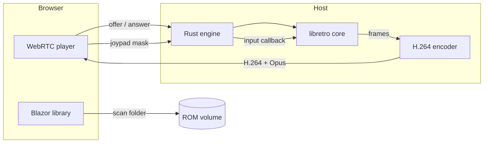

# PixelPipe

Self-hosted Plex for retro games. ROMs and libretro cores run on a machine you control. Gameplay video and audio are encoded on that machine and streamed to a browser on the same LAN, and controller input comes back over the same WebRTC session. PixelPipe is one application: it does not sit on top of Sunshine, Apollo, Moonlight, or RomM.

The latency target is about 10–30 ms end to end on a home network. The player HUD adds the pieces we can time: libx264 encode, data-channel RTT, the browser jitter buffer, and decode. On this development host, streaming the test ROM to a local Chrome tab measured about **0.2 ms encode, 0.1 ms decode, 1.2 ms RTT, 17–25 ms jitter buffer, and an estimated 18–26 ms** glass-to-glass. A headless self-test of the same 256×240 frame encoded in about 0.2 ms average. The jitter buffer is the largest term at this resolution; NVENC will not remove it, but it keeps the encode step small on a machine that is also doing other work. A browser on another LAN device adds its own RTT.

## Architecture

```text
browser (Blazor + MudBlazor)
    library grid, game detail, settings, player page
        |  HTTP  (library is scanned by the UI; session control is the engine)
        v
engine (Rust)
    libretro core  --video/audio callbacks-->  H.264 + Opus
        ^                                        |
        | data channel (gamepad / keyboard)      v
        +---------------- WebRTC ----------------+
```

- **UI** (`ui/PixelPipe.Web`): Blazor Server and MudBlazor. The library page scans a folder, shows box art, and opens a player page.
- **Engine** (`engine/`): loads a libretro core with `dlopen`, runs it headless, takes frames from the video callback and PCM from the audio callback, encodes H.264, encodes Opus, and sends both on a WebRTC peer connection. Browser input arrives on an unreliable data channel and is fed to `retro_input_state`.
- **Encoder order**, probed by actually opening the codec at startup: NVIDIA NVENC (`h264_nvenc`), Intel Quick Sync (`h264_qsv`), VAAPI (`h264_vaapi`), AMD AMF (`h264_amf`), then libx264. Machines without a GPU use libx264. The software path is tuned for latency (`ultrafast`, `zerolatency`, no B-frames, intra refresh off, headers repeated on every IDR).
- **Packaging**: one Docker image runs both processes. The ROM library is a volume. Images are built for `linux/amd64` and `linux/arm64`; cores are downloaded from the libretro buildbot for the target architecture.



## Milestone 1

Working in this tree:

- Repository layout, `.gitignore`, GitHub Actions build of the engine and the UI, Dockerfile and Compose.
- FCEUmm loads the bundled CC0 NES ROM headless. A self-test checks that the picture is not black, that audio is produced, that holding Right moves the on-screen cursor, that a frame round-trips through libx264, and that save states serialize.
- Encoder probe prefers NVENC and falls through to libx264 when the GPU encoder cannot be opened.
- WebRTC video and audio to the player page, with keyboard and one Gamepad API controller mapped onto the libretro joypad. Save and load of one state slot.
- Blazor library, game detail, settings (encoder probe and core inventory), and player.

Not in this milestone: SNES and Genesis are wired (extension → core) and the cores load, but they are not exercised with a ROM here. No second player, no Tailscale remote play, no profiles, no cloud saves, no No-Intro DAT matching. VAAPI and Quick Sync are probed by opening the encoder; they need a hardware pixel format this build does not upload yet, so a GPU-only machine still falls through to libx264 when `h264_vaapi` or `h264_qsv` refuses `yuv420p`. One session at a time. `.md` files that are plain text (such as this folder's notes) are not treated as Genesis ROMs.

## Run it

### Docker Compose

```bash
export PIXELPIPE_ROMS=/path/to/roms          # local folder or UNAS mount
export PIXELPIPE_ADVERTISE_IP=192.168.1.20  # this host's LAN address
docker compose up --build
```

Open `http://<host>:8080`. UDP `50000-50100` is published for WebRTC. Set `PIXELPIPE_ADVERTISE_IP` to the address browsers can reach; without it, ICE candidates use the container address and a browser on another device will not connect. On a single machine, `network_mode: host` also works and you can leave the advertise address empty.

The image contains the UI on port 8080 and the engine on port 9090. The ROM volume is mounted read-only at `/roms`. Save states and SRAM go to the `pixelpipe-data` volume, not back onto the NAS share.

### Local, without Docker

```bash
# Ubuntu/Debian build dependencies
sudo apt-get install -y pkg-config clang libclang-dev \
  libavcodec-dev libavformat-dev libavutil-dev libswscale-dev libswresample-dev libopus-dev
# .NET 8 SDK on PATH

bash scripts/fetch-cores.sh
python3 scripts/build-test-rom.py   # already committed; rerun if you change the ROM
cargo build --manifest-path engine/Cargo.toml
cargo test --manifest-path engine/Cargo.toml
./engine/target/debug/pixelpipe-engine --self-test
./scripts/dev.sh
```

`scripts/dev.sh` starts the engine on `:9090` and the Blazor app on `:8080`.

Play **PixelPipe Test**. Click the video, then the arrow keys. Z is B, X is A, Enter is Start, Shift is Select. A gamepad's face buttons and D-pad follow the standard mapping. The HUD prints encode time, data-channel RTT, jitter-buffer delay, decode time, and a sum of those as an estimated glass-to-glass latency. That sum does not include display refresh.

There is also a same-origin debug player at `http://127.0.0.1:9090/player`.

## Library

The scanner walks the ROM folder (up to 12 levels). A game's identity is its path, a CRC32 of the file, and, for iNES files, a second CRC32 of the ROM with the 16-byte header removed. `roms/library.json` overrides title, developer, year, and description. Box art is `<rom>.png` beside the file, `boxart/<name>.png`, or `boxart/<crc32>.png`. Anything else gets a generated poster.

SRAM (when the core exposes it) is written to `data/saves/<crc32>.srm` on session stop and restored on the next launch. One save state per ROM is `data/saves/<crc32>.state`.

## Cores and licenses

Cores are loaded at runtime. They are not compiled into the engine. Fetch them with `scripts/fetch-cores.sh` or let the Docker build do it. Details and upstream links are in `cores/README.md`.

- **FCEUmm** is GNU GPL v2. If you distribute a build that includes the FCEUmm binary, the combined work is easiest to treat as GPLv2: ship this repository's source and point at the corresponding core source (the libretro FCEUmm tree, or the buildbot revision you downloaded).
- **Snes9x** allows non-commercial / personal use. Commercial use is not granted.
- **Genesis Plus GX** allows redistribution only for non-commercial use, and modified redistributions must include source.

PixelPipe's own engine and UI do not add a separate license in this milestone. Do not ship Snes9x or Genesis Plus GX in a commercial product.

The only ROM in the repository is `roms/homebrew/pixelpipe-test.nes` (CC0, source is `scripts/build-test-rom.py`).

## Roadmap

1. Finish hardware encode on VAAPI (hardware frames) and confirm NVENC on the owner's NVIDIA host. Keep the same encoder interface.
2. Exercise Snes9x and Genesis Plus GX with redistributable homebrew, including a real sample-rate resample check.
3. No-Intro / Redump DAT identification, richer metadata, and scraped box art with a local cache.
4. More than one session, per-game core options, and hotkey save states.
5. Remote play over Tailscale: STUN is already an env var (`PIXELPIPE_STUN`); relay and auth come after.
6. Profiles and cloud saves.

## Layout

```text
engine/                 Rust crate (pixelpipe-engine)
ui/PixelPipe.Web/       Blazor Server + MudBlazor
roms/                   library mount, plus the CC0 test ROM
cores/                  downloaded libretro cores (gitignored)
scripts/fetch-cores.sh
scripts/build-test-rom.py
scripts/dev.sh
Dockerfile
docker-compose.yml
```
